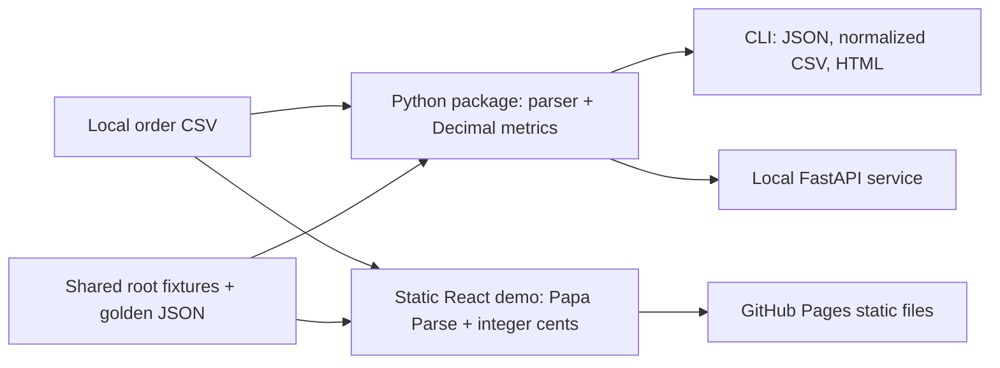

# Architecture

Rowcraft keeps one input contract and separates three execution contexts:

The Python package is the reusable business engine. The FastAPI service is a local developer demo and accepts CSV only; it does not store files. GitHub Pages serves the React build as static assets. The browser demo parses and calculates locally and has no API call, account, telemetry, or credentials. Shared fixtures and `golden-report.json` keep the Python and TypeScript implementations aligned.

Python uses `Decimal` for exact base-10 input and rounds money to two decimals for presentation. The browser parses prices to integer cents and only supports two-decimal currency inputs. Both reject mixed currencies. The product is deliberately a one-currency report, not an accounting ledger.
